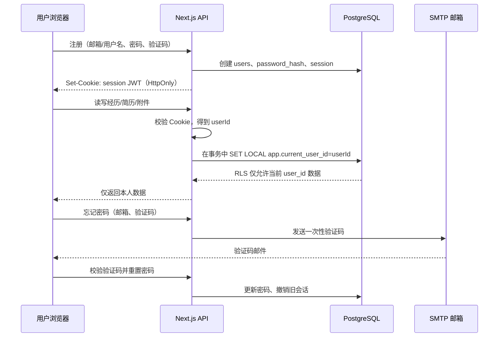

# 多用户账户与数据隔离技术规格说明书（低成本上线方案）

> 状态：已由 Supabase 方案实施。本文中“自建会话/JWT/SMTP/验证码”的旧设计不再适用，实施与部署以 [SUPABASE_SETUP.md](SUPABASE_SETUP.md)、[db/migrations/0004_supabase_auth_isolation.sql](db/migrations/0004_supabase_auth_isolation.sql) 和 [tests/good-bad-cases.md](tests/good-bad-cases.md) 为准。  
> 目标：在保留当前 Next.js + PostgreSQL 架构的基础上，让不同用户注册、登录并安全使用个人经历库与简历生成；任一用户不得读取、修改、下载或筛选到其他用户的数据。

## 1. 结论与方案选择

采用“Supabase Auth + Supabase PostgreSQL RLS + 私有 Supabase Storage”方案。

身份会话由 Supabase 的安全 Cookie 管理；Next.js 服务端通过 `supabase.auth.getUser()` 得到可信 `auth.users.id`。客户端不能指定 `user_id`，所有业务写入均由服务端赋值；PostgreSQL 和 Storage 另以 RLS 再次隔离。附件不再依赖部署机器的磁盘，因此可在托管环境稳定运行。

## 2. 范围与非目标

本期范围：

- 用户名或邮箱注册、登录、退出；
- 密码修改、忘记密码和邮件验证码重置；
- 本地滑块/拼图验证码、接口限流、连续失败锁定；
- 经历、附件、简历资料、JD、草稿、Word 导出在用户间隔离；
- PostgreSQL Row-Level Security（RLS）和应用层所有权校验；
- 旧的 `local-user` 本地数据迁移策略。

本期不做：第三方 OAuth 登录、短信验证码、团队共享空间、管理员代看用户简历、付费订阅和细粒度角色权限。

## 3. 核心业务链路



### 3.1 注册

1. 用户填写用户名、邮箱、密码并通过本地验证码。
2. 后端验证用户名和邮箱唯一、密码强度与验证码。
3. 使用 `bcryptjs`（成本因子 12）保存密码哈希，绝不保存明文密码。
4. 使用 `crypto.randomUUID()` 生成文本型 UUID `user_id`。
5. 创建用户、会话记录，签发会话 Cookie。

用户名规则：3–32 个字符，字母、数字、下划线；邮箱唯一并统一小写。密码规则：至少 10 位，且包含至少两种字符类别；不允许与用户名或邮箱完全相同。

### 3.2 登录、会话与退出

1. 登录接口接收“用户名或邮箱 + 密码 + 验证码”。
2. 登录成功后创建一条 `auth_sessions`，签发 7 天有效的 JWT Cookie。
3. JWT 只保存 `sub`（user_id）、`sid`（session_id）、`iat`、`exp`，不保存邮箱、密码或业务资料。
4. 每次业务接口请求均验证 JWT 签名、过期时间和对应 session 是否未撤销、未过期。
5. 退出登录时撤销当前 `auth_sessions`，并清除 Cookie。

Cookie 建议：`HttpOnly; Secure; SameSite=Lax; Path=/; Max-Age=604800`。本地开发时允许不设置 `Secure`；生产环境必须启用 HTTPS。

### 3.3 找回及重置密码

1. 用户提交邮箱和验证码挑战。
2. 即使邮箱不存在，也返回统一提示“如账户存在，验证码已发送”，避免枚举账户。
3. 后端生成 6 位一次性验证码，数据库只存 HMAC/哈希、用途、过期时间（10 分钟）和发送次数。
4. 邮件通过 Nodemailer 和可配置 SMTP 发出。SMTP 服务可以使用邮箱服务商提供的免费额度，但要配置域名发信认证（SPF/DKIM/DMARC）。
5. 用户验证通过后设置新密码，服务端撤销该用户全部既有会话。

### 3.4 验证码与防暴力破解

本地滑块验证码只能提高机器攻击成本，不能单独视为安全边界。还必须实现：

- 登录、注册、找回密码接口按 IP、邮箱/用户名双维度限流；
- 登录连续失败 5 次，锁定账号 15 分钟；
- 重置验证码每邮箱 10 分钟最多 3 次、每天最多 10 次；
- 所有敏感失败事件写入审计日志，但不记录密码或验证码明文；
- 生产环境在反向代理层额外限流。

## 4. 数据隔离设计

### 4.1 关键规则

1. 客户端不得提交或指定 `user_id`。
2. 服务端只从已验证会话中取得 `userId`。
3. 每一个业务查询和写入都必须以该 `userId` 为归属条件。
4. 数据库启用 RLS，作为应用层过滤遗漏时的第二道保护。
5. 附件下载按“文件 ID + 当前用户归属”共同验证，不能只凭 UUID 下载。

### 4.2 表与所有权

为降低 RLS 策略和查询复杂度，所有用户可见或可访问的表均保存直接 `user_id`，而非只依赖多层关联。

| 表 | `user_id` | 隔离方式 |
| --- | --- | --- |
| `users` | 主键 `id` | 仅允许读取/更新本人；密码字段永不返回客户端 |
| `auth_sessions` | 必填 | 仅会话所属用户可管理本人会话 |
| `password_reset_codes` | 必填 | 仅后端认证流程访问 |
| `library_state` | 必填且唯一 | 每用户一条经历库 JSONB 状态 |
| `files` | 必填 | 上传、列举、下载均校验文件所属用户 |
| `source_chunks` | 必填 | 与附件同一用户；不直接向其他用户暴露 |
| `experiences`、`evidence_points`、`merge_decisions` | 必填 | 为后续规范化经历库预留 |
| `education_records`、`resume_profiles` | 必填 | 仅本人资料 |
| `resume_projects`、`job_descriptions`、`resume_selections`、`resume_versions` | 必填 | 仅本人简历项目和草稿 |
| `audit_logs` | 可选 `user_id` | 仅服务端/管理员审计，不对普通接口开放 |

`user_id` 继续使用当前兼容的 `text` 列，内容为 UUID 字符串。迁移后移除所有 `default('local-user')` 默认值，避免遗漏写入公共账户。

### 4.3 RLS 策略

应用连接数据库后，在每次业务请求的数据库事务内执行：

```sql
SELECT set_config('app.current_user_id', :user_id, true);
```

对用户表以外的用户数据表启用策略：

```sql
ALTER TABLE files ENABLE ROW LEVEL SECURITY;
ALTER TABLE files FORCE ROW LEVEL SECURITY;

CREATE POLICY files_owner_only ON files
  USING (user_id = current_setting('app.current_user_id', true))
  WITH CHECK (user_id = current_setting('app.current_user_id', true));
```

每张带 `user_id` 的业务表应用同类策略。`FORCE ROW LEVEL SECURITY` 防止表所有者在常规查询中意外绕过策略。认证相关表由单独的受限数据库访问函数或服务端专用连接访问，不对普通业务事务开放。

### 4.4 附件隔离

文件保存路径必须分用户命名空间：

```text
local-data/uploads/<user_id>/<file_id>.<extension>
```

`GET /api/files/:id` 的查询必须等同于：

```sql
SELECT * FROM files WHERE id = :file_id AND user_id = :current_user_id;
```

查不到时统一返回 `404`，而不是提示“该文件属于其他用户”，避免泄露文件是否存在。未来换对象存储时，使用 `<user_id>/<file_id>` 对象键和短时签名 URL。

## 5. 接口规格

### 5.1 认证接口

| 方法 | 路径 | 请求 | 成功响应 |
| --- | --- | --- | --- |
| `POST` | `/api/auth/register` | `username, email, password, captchaToken` | `201 { user: { id, username, email } }` 并写 Cookie |
| `POST` | `/api/auth/login` | `identifier, password, captchaToken` | `200 { user }` 并写 Cookie |
| `POST` | `/api/auth/logout` | 无 | `204`，撤销会话并清 Cookie |
| `GET` | `/api/auth/me` | Cookie | `200 { user: { id, username, email } }` |
| `POST` | `/api/auth/change-password` | `currentPassword, newPassword` | `204`，撤销其他会话 |
| `POST` | `/api/auth/password-reset/request` | `email, captchaToken` | 始终 `202` |
| `POST` | `/api/auth/password-reset/confirm` | `email, code, newPassword` | `204`，撤销全部旧会话 |
| `POST` | `/api/auth/captcha/challenge` | 无 | `{ challengeId, image/puzzlePayload }` |
| `POST` | `/api/auth/captcha/verify` | `challengeId, answer` | 短时 `captchaToken` |

认证失败统一为 `401` 或 `400`，不透露“邮箱不存在”“用户名存在但密码错误”等细节。所有写接口校验 `Origin`，Cookie 采用 `SameSite=Lax`，避免跨站请求伪造。

### 5.2 现有业务接口的变更

所有现有 `/api/*` 业务接口（认证接口除外）均先调用 `requireUser()`。未登录返回：

```json
{ "error": "请先登录后再访问个人数据" }
```

状态码为 `401`。

| 接口 | 必须变更 |
| --- | --- |
| `GET/PUT /api/library` | 使用会话 `userId` 查询/更新 `library_state`，不再使用 `local-user` |
| `POST /api/process` | `files`、`source_chunks`、上传目录写入 `userId` |
| `GET /api/files/:id` | 先通过当前用户所有权查询文件，再读取磁盘文件 |
| `GET/PUT /api/resume-profile` | 仅访问当前用户资料 |
| `POST /api/resume/analyze`、`supplement`、`generate` | 必须登录；处理中的输入仅属于当前会话，不接收客户端 `userId` |
| `GET/POST /api/resumes` | 项目、JD、选择、版本全部以当前用户创建与查询 |
| `POST /api/resumes/word` | 仅可导出当前用户草稿；若接收草稿 ID，必须按 `id + userId` 读取服务器草稿，不信任客户端内容 |

现有 `/api/resumes/word` 在上线版应从“客户端传入完整草稿”改为：`POST /api/resumes/:versionId/word`。后端按当前用户读取版本后导出，避免用户篡改或导出不属于自己的版本。

## 6. 模块与目录建议

```text
app/
  (auth)/login/page.tsx
  (auth)/register/page.tsx
  (auth)/forgot-password/page.tsx
  api/auth/
    register/route.ts
    login/route.ts
    logout/route.ts
    me/route.ts
    change-password/route.ts
    password-reset/request/route.ts
    password-reset/confirm/route.ts
    captcha/challenge/route.ts
    captcha/verify/route.ts
lib/auth/
  password.ts          # bcryptjs 哈希与密码规则
  session.ts           # JWT 签发、Cookie、会话校验与撤销
  require-user.ts      # Route Handler 中取得已验证 userId
  captcha.ts           # 短时挑战和验证
  rate-limit.ts        # PostgreSQL 限流与账号锁定
  ownership.ts         # 文件/草稿等资源所有权校验
db/
  schema.ts            # users、sessions、reset codes、所有 user_id 字段
  migrations/0004_auth_and_isolation.sql
  client.ts            # 带 user context 的 transaction helper
middleware.ts          # 页面访问拦截；API 仍以 requireUser 为准
```

建议新增依赖：

- `jose`：签发/验证 JWT；
- `bcryptjs`：密码哈希，无需编译原生模块；
- `nodemailer`：SMTP 邮件发送；
- 可选 `zod`：统一校验 API 输入。

以上均为开源依赖；真正可能产生费用的是 SMTP 发信服务、域名与部署服务，而不是账户隔离本身。

## 7. 数据库迁移方案

### 7.1 新表

```text
users
  id text primary key                 # UUID 字符串
  username text unique not null
  email text unique not null
  password_hash text not null
  status text not null                # active / locked / disabled
  failed_login_count integer not null
  locked_until timestamptz null
  created_at, updated_at, last_login_at

auth_sessions
  id text primary key
  user_id text references users(id)
  expires_at, revoked_at, created_at, last_seen_at
  user_agent_hash, ip_hash

password_reset_codes
  id text primary key
  user_id text references users(id)
  code_hash text not null
  expires_at, consumed_at, created_at

auth_rate_limits
  scope text, key_hash text, window_start timestamptz
  count integer, primary key(scope, key_hash, window_start)

audit_logs
  id text primary key
  user_id text null
  event_type text, ip_hash text, metadata jsonb, created_at
```

### 7.2 既有数据处理

当前本地版全部使用 `local-user`。上线前必须二选一：

1. **无保留需求**：清空本地测试数据，迁移后由每个用户重新注册和上传；最简单且最安全。
2. **需要保留当前开发者数据**：先由开发者注册首个账户，执行一次性迁移脚本，将所有 `local-user` 记录改写为该账户 UUID，并把原始附件移动到该 UUID 目录。

不可在生产环境中保留 `local-user` 作为公共默认值。迁移完成后增加 `NOT NULL`、外键、索引并删除默认值。

## 8. 安全验收标准

上线前必须自动化验证以下场景：

1. 用户 A 上传的经历、附件、简历草稿，用户 B 的列表、搜索与筛选接口均不可见。
2. 用户 B 手动构造用户 A 的文件 UUID、草稿 UUID、经历 ID 请求时，响应为 `404` 或 `403`，且不泄露资源名称。
3. 修改请求体中的任何 `user_id` 都不会改变资源归属。
4. 用户 B 无法用用户 A 的已撤销 Cookie 访问任何业务接口。
5. 用户重置密码后，其所有旧会话失效。
6. 账号锁定、验证码过期、接口限流和跨站请求验证均生效。
7. RLS 打开时，即使代码遗漏了 `WHERE user_id = ...`，数据库也不返回其他用户记录。
8. 文件路径不能通过 `../` 或直接静态 URL 越过 API 的所有权校验。

## 9. 实施顺序

1. 新增用户、会话、验证码、限流表及迁移；为既有表补齐 `user_id` 和索引。
2. 实现密码哈希、会话 Cookie、`requireUser()` 和认证接口。
3. 将所有业务接口中的 `local-user` 替换为服务端会话用户，并为附件、草稿增加所有权校验。
4. 启用 RLS 与数据库请求上下文；补充越权自动化测试。
5. 增加登录/注册/找回密码页面及本地验证码交互。
6. 执行旧数据迁移，使用两个测试用户完成隔离与导出测试。
7. 部署前配置 HTTPS、`JWT_SECRET`、SMTP、生产数据库备份与日志保留策略。

## 10. 运行配置

```dotenv
DATABASE_URL=postgresql://...
AUTH_JWT_SECRET=<至少 32 字节的随机密钥>
AUTH_COOKIE_NAME=experience_session
SMTP_HOST=smtp.example.com
SMTP_PORT=465
SMTP_USER=no-reply@example.com
SMTP_PASSWORD=<SMTP 专用密码>
SMTP_FROM=经历库 <no-reply@example.com>
```

`AUTH_JWT_SECRET`、SMTP 密码和 DeepSeek API Key 均只能保存在部署环境变量中，不能提交到 Git 仓库，也不能返回给浏览器。
