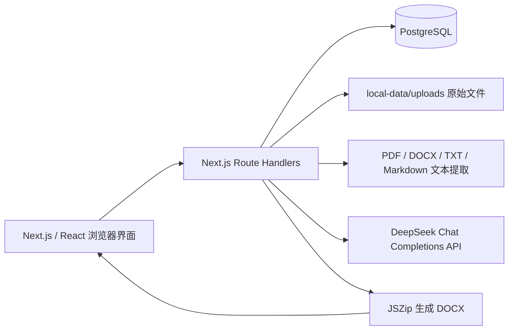
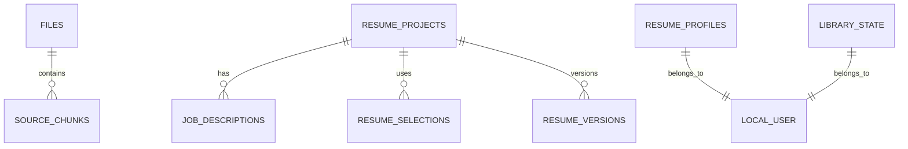

# AI 求职助手技术规格说明书（本地 MVP）

> 文档版本：v0.1  
> 适用范围：当前已实现的「个人经历库」「简历资料」「简历生成与导出」功能。本文以现有代码与数据库结构为准，不把尚未实现的能力写成已交付能力。

## 1. 产品目标与边界

本系统帮助本地单用户将求职相关材料沉淀为可追溯的个人经历库，并基于目标岗位 JD 生成定制化简历。

已实现的核心原则：

- 原始上传文件保留在本地；AI 只做结构化、润色和摘要，不应虚构经历事实。
- 个人经历被统一归类为：`工作经历`、`实习经历`、`项目经历`、`校园经历`。
- 项目经历、校园经历允许没有机构名称；页面和简历中不展示“机构待确认”一类占位文本。
- 简历生成仅使用用户选择并确认的经历快照，不回写或覆盖个人经历库。
- 用户资料（姓名、电话、邮箱、教育经历、专业技能、资格证书）独立保存，可在每次生成简历时复用与临时调整。
- 不实现 ATS 评分、不进行联网搜索、不使用外部面经或评价作为生成依据。

当前不属于本地 MVP 的能力：账户体系、多用户隔离、云端对象存储、扫描件 OCR、自动涉密识别、真实双语两份文档导出、简历模板切换和异步任务队列。

## 2. 总体架构



系统运行于本机。浏览器通过 Next.js API 与本地 PostgreSQL、项目目录中的上传附件交互；需要 AI 的步骤将对应的文本、JD 或已选经历发送到 DeepSeek API。

## 3. 技术栈

| 层级 | 技术 | 用途 |
| --- | --- | --- |
| 前端与服务端 | Next.js 16.2.6、React 19.2.6、TypeScript 5.9.3 | 页面、交互状态与 API Route Handlers |
| 数据库 | PostgreSQL | 经历库状态、附件元数据、简历资料、简历项目和版本 |
| ORM | Drizzle ORM、`pg` | 表结构定义、迁移与数据库读写 |
| AI | DeepSeek Chat Completions API，默认 `deepseek-v4-flash` | 经历抽取、JD 分析、补充建议、简历改写与生成 |
| 文档解析 | `pdf-parse`、`mammoth`、Node.js UTF-8 读取 | 分别解析 PDF、DOCX、TXT/Markdown |
| 文件存储 | 本地文件系统 `local-data/uploads` | 保存用户原始上传文件 |
| Word 导出 | JSZip | 组装 Open XML 并下载 `.docx` |
| 样式 | 全局 CSS（`app/globals.css`），项目包含 Tailwind CSS 依赖 | 页面布局和视觉样式 |

## 4. 功能规格

### 4.1 个人经历库

1. 用户上传 PDF、DOCX、TXT 或 Markdown 文件（界面提示单文件不超过 20MB）。
2. 服务端先把原始文件写入 `local-data/uploads`，再在数据库创建附件记录。
3. 服务端提取文本，按段落生成来源片段（source chunks）。
4. DeepSeek 将本次材料抽取为经历候选、证据点、标签和待确认问题；每个事实应关联来源片段 ID。
5. 用户在界面审核后新增或合并经历。当前合并策略主要按标题、机构和时间段的规范化精确匹配；合并时去重标签、证据和来源材料。
6. 用户可手动新建、编辑、归档或删除经历，并查看来源材料和整理记录。

当前 UI 的个人经历数据主存储为 `library_state.experiences` JSONB。`experiences`、`evidence_points` 等规范化表已建好，作为后续逐步迁移到细粒度关系模型的基础。

### 4.2 简历资料

用户可维护可复用的简历资料：

- 基本信息：姓名、电话、邮箱；
- 教育经历：学校、专业、起止年份；
- 专业技能；
- 资格证书。

资料存于 `resume_profiles`。生成简历时默认载入，但可针对当前草稿增删技能与证书，草稿的修改以快照形式保存，不覆盖资料库原值。

### 4.3 简历生成流程

| 步骤 | 输入/操作 | 输出与约束 |
| --- | --- | --- |
| 1. 输入岗位 | 目标岗位、可选公司、1 份主 JD、最多 5 份参考 JD、语言 | 主 JD 必填；默认中文 |
| 2. 分析岗位 | 发送主 JD 和参考 JD | 输出主 JD 关键词、参考 JD 补充、共同高频要求及岗位画像；三类关键词明确分源 |
| 3. 选择经历 | 用户从经历库勾选，并可指定必用经历 | 未选择经历不能进入下一步；选择结果成为后续唯一可用的经历范围 |
| 4. 补充信息 | AI 审查已选经历，用户采用 AI 稿、手动编辑或保持原文 | 每段经历给出 JD 对应关系、具体薄弱点、真实信息追问、改写摘要与 2–4 条简历要点；AI 不得编造数字或责任 |
| 5. 生成简历 | 基于岗位分析、用户确认后的经历快照和简历资料 | 生成一页简历草稿，保存历史版本，支持打开历史草稿和导出 Word |

最终预览及 Word 导出按照以下大类顺序排版：`工作经历 → 实习经历 → 项目经历 → 校园经历`；每个大类内部按结束时间从近到远排序。空机构名不会显示占位文本。

“中英文双份”选项当前会生成中文主版本，并在生成说明中提示英文版待后续实现；它不等价于已导出两份完整简历。

## 5. AI 调用与事实约束

所有 AI 调用使用 JSON Object 响应格式，温度为 0.1–0.15。核心调用包括：

| 场景 | 函数 | 输入 | 关键约束 |
| --- | --- | --- | --- |
| 经历整理 | `analyseExperience` | 来源片段 | 仅抽取原文事实；每段经历只可归入四类之一；每个事实保留来源片段 ID |
| JD 分析 | `analyseJobDescriptions` | 主 JD、参考 JD | 明确拆分主 JD、参考 JD、共同关键词；禁止引入 JD 以外的岗位信息 |
| 补充建议 | `createSupplementAdvice` | 岗位画像、已选经历 | 基于事实锁与 JD 视角输出具体问题、STAR 要点和改动说明；缺少量化信息时询问用户而非造数；会重试过于接近原文的输出，不再进行第二次 AI 事实校验 |
| 简历生成 | `generateTailoredResume` | 岗位、语言、岗位画像、已确认经历 | 只使用用户确认的经历事实；优先 JD 相关事实；技能数组必须留空，由用户资料库提供 |

AI 生成失败、返回结构缺字段或改写稿与原文无法区分时，服务端会返回错误，不应把无效结果当作成功结果继续进入下一步。

## 6. 数据模型

### 6.1 主要实体关系



当前本地版本固定使用 `user_id = local-user`，尚未实现认证和多用户隔离。

### 6.2 数据表

| 表 | 关键字段 | 当前用途 |
| --- | --- | --- |
| `library_state` | `user_id`、`experiences JSONB`、`updated_at` | 当前个人经历库主状态 |
| `files` | `id`、`original_name`、`mime_type`、`storage_path`、`status`、`risk_flags` | 原始附件的元数据 |
| `source_chunks` | `file_id`、`sequence`、`page_number`、`content` | 从附件解析出的可追溯文本片段 |
| `experiences` | 类型、机构、职位、时间、摘要、状态 | 预留的规范化经历表，当前不是 UI 主读写路径 |
| `evidence_points` | `experience_id`、内容、技能/标签、来源片段 ID、置信度 | 预留的规范化证据表 |
| `merge_decisions` | `file_id`、候选经历、决策、原因、载荷 | 预留的合并决策审计表 |
| `education_records` | 学校、学位、专业、时间、详情 | 预留的规范化教育表；当前资料页使用 profile JSONB |
| `resume_profiles` | 姓名、电话、邮箱、教育 JSONB、技能 JSONB、证书 JSONB | 可复用简历资料 |
| `resume_projects` | 公司、目标岗位、语言、页数、状态 | 一次简历生成任务 |
| `job_descriptions` | `project_id`、来源角色、JD 内容、分析 JSONB | 主 JD / 参考 JD 及其分析 |
| `resume_selections` | `project_id`、经历引用、是否必用、排序 | 本次简历选用的经历 |
| `resume_versions` | `project_id`、语言、内容 JSONB、用户编辑 | 可打开和导出的简历草稿版本 |

### 6.3 核心 JSON 数据结构

`Experience`（存于 `library_state.experiences`）应包含：

```ts
type Experience = {
  id: number;
  type: "工作经历" | "实习经历" | "项目经历" | "校园经历";
  title: string;
  org: string;
  period: string;
  summary: string;
  tags: string[];
  evidence: string[];
  sourceFileIds?: string[];
};
```

简历生成阶段的关键类型定义在 `lib/resume-types.ts`：

```ts
type ResumeExperienceInput = {
  id: number; title: string; org: string; period: string; type: string;
  summary: string; tags: string[]; evidence?: string[];
  reviewMode?: "ai" | "manual" | "original";
  originalSummary?: string;
};

type ResumeProfile = {
  name: string; phone: string; email: string;
  educations: Array<{ id: string; school: string; major: string; startYear: string; endYear: string }>;
  professionalSkills: string[];
  certificates: string[];
};
```

`JobAnalysis` 主要包含 `main_jd_keywords`、`reference_jd_keywords`、`common_keywords`、岗位职责、工具方法、领域术语和候选人要求。每个关键词记录 `keyword`、`source`、`importance`、`evidence`。

`ResumeDraft` 保存草稿标题、岗位、语言、JD、分析结果、所选经历、简历资料快照、证书及 AI 生成的经历要点。

## 7. HTTP 接口定义

除附件上传外，接口均为 JSON。错误一般返回 `{ error: string }`，参数错误为 `400`，AI/解析业务错误通常为 `422`，缺少数据库配置为 `503`。

### 7.1 经历库与附件

| 方法与路径 | 请求 | 成功响应 | 说明 |
| --- | --- | --- | --- |
| `GET /api/library` | 无 | `{ experiences }` | 读取当前经历库 |
| `PUT /api/library` | `{ experiences: Experience[] }` | `{ ok: true, count }` | 覆盖保存当前经历库 JSONB 状态 |
| `POST /api/process` | `multipart/form-data`，字段 `file` | `{ fileId, fileUrl, analysis }` | 保存附件、提取文本、AI 整理经历候选 |
| `GET /api/files/:id` | 无 | 文件流 | 以 inline 方式查看原始附件 |

`POST /api/process` 的 `analysis` 包含：`document_analysis`、`experience_candidates`、`merge_plan`、`questions_for_user`。失败信息会标明发生在保存、文本提取或 AI 整理的哪个阶段。

### 7.2 简历资料

| 方法与路径 | 请求 | 成功响应 |
| --- | --- | --- |
| `GET /api/resume-profile` | 无 | `{ profile: ResumeProfile }`；没有记录时返回空默认值 |
| `PUT /api/resume-profile` | `ResumeProfile` 的全部或部分字段 | `{ profile: ResumeProfile }` |

服务端会清理空字符串并对技能、证书去重；空教育条目不保存。

### 7.3 简历生成

| 方法与路径 | 请求 | 成功响应 | 说明 |
| --- | --- | --- | --- |
| `POST /api/resume/analyze` | `{ role, mainJD, references? }` | `{ analysis: JobAnalysis }` | `references` 最多 5 条 |
| `POST /api/resume/supplement` | `{ analysis, experiences }` | `{ supplement: SupplementResult }` | 生成逐段建议、问询和修改稿 |
| `POST /api/resume/generate` | `{ role, language, analysis, experiences }` | `{ resume: GeneratedResume }` | 生成本次确认经历的简历内容 |
| `GET /api/resumes` | 无 | `{ drafts: ResumeDraft[] }` | 按创建时间倒序读取草稿历史 |
| `POST /api/resumes` | `ResumeDraft` | `{ draft }` | 创建项目、JD、选择和版本记录 |
| `POST /api/resumes/word` | `ResumeDraft` | `.docx` 文件流 | 下载 Word 文档 |

`SupplementResult.advice` 的每项对应一个 `experience_id`，包含：匹配理由、匹配要求、`missing_or_weak_points`、`suggested_bullets`、`changes_made`。不输出总起式经历概述；可写入简历的内容统一由互不重复的 STAR 要点承载。`missing_or_weak_points` 包含 `location`、`problem`、`jd_reason`、`question`，用于将“缺少量化结果”等泛化提醒落实到某条经历的具体位置。

## 8. 目录结构

```text
wo/
├── app/
│   ├── api/
│   │   ├── files/[id]/route.ts              # 查看原始附件
│   │   ├── library/route.ts                 # 经历库状态读写
│   │   ├── process/route.ts                 # 上传、解析、AI 整理
│   │   ├── resume-profile/route.ts          # 简历资料读写
│   │   ├── resume/analyze/route.ts          # JD 分析
│   │   ├── resume/generate/route.ts         # 简历内容生成
│   │   ├── resume/supplement/route.ts       # 逐段建议与改写
│   │   ├── resumes/route.ts                 # 草稿历史、草稿保存
│   │   └── resumes/word/route.ts            # Word 导出
│   ├── globals.css                           # 全局样式
│   ├── layout.tsx                            # 根布局
│   └── page.tsx                              # 应用主入口与侧边栏
├── components/
│   ├── ResumeProfilePage.tsx                 # 简历资料页面
│   └── ResumePrototype.tsx                   # 五步简历生成流程与预览
├── db/
│   ├── client.ts                             # PostgreSQL / Drizzle 客户端
│   ├── schema.ts                             # Drizzle 表定义
│   └── migrations/                           # 0000–0003 SQL 迁移
├── lib/
│   ├── deepseek.ts                           # 经历材料 AI 整理
│   ├── extract.ts                            # 文档文本提取
│   ├── resume-ai.ts                          # JD、建议、简历的 AI 调用
│   └── resume-types.ts                       # 简历领域 TypeScript 类型
├── scripts/preflight.mjs                     # 开发前置检查
├── local-data/uploads/                       # 运行时原始附件（不应提交）
├── package.json
└── spec.md
```

## 9. 配置、迁移与本地运行

项目根目录 `.env` 需要至少包含：

```dotenv
DATABASE_URL=postgresql://<用户名>@127.0.0.1:5432/experience_library
DEEPSEEK_API_KEY=<你的 DeepSeek API Key>
# 可选；未设置时为 deepseek-v4-flash
DEEPSEEK_MODEL=deepseek-v4-flash
```

首次建库后执行迁移：

```bash
psql -d experience_library -f db/migrations/0000_init.sql
psql -d experience_library -f db/migrations/0001_library_state.sql
psql -d experience_library -f db/migrations/0002_resume_generation.sql
psql -d experience_library -f db/migrations/0003_resume_profile.sql
```

常用命令：

```bash
npm install
npm run dev       # 开发服务器固定为 http://localhost:3100
npm run build     # 生产构建校验
npm run test      # 构建与项目测试
npm run lint
```

开发服务器必须保持对应终端窗口运行；终端进程结束后，`localhost:3100` 会显示连接被拒绝。

## 10. 隐私、安全与数据处理

- 前端在上传前要求用户确认材料不含雇主保密信息且拥有上传和使用权。此为用户声明，当前尚无可靠的自动涉密识别能力。
- 原始文件保存在项目本机目录，数据库仅保存其路径和元数据。
- 需要 AI 处理时，文档提取文本、JD 和用户确认的经历会发送给 DeepSeek API；不应在生产环境中使用明文日志记录 API Key 或用户完整材料。
- `.env`、`local-data/uploads/` 和本地数据库均属于敏感本地数据，应加入 `.gitignore`，不得提交至公开仓库。
- 当前只有固定本地用户，不适合直接暴露到公网；上线前需要身份认证、授权、租户隔离、对象存储权限控制、删除机制和审计能力。

## 11. 已知限制与后续演进建议

1. **扫描 PDF 无 OCR**：当前 PDF 仅提取可复制文本；扫描件/图片型 PDF 需要后续接入 OCR。
2. **附件存储不可横向扩展**：本地文件路径适合单机开发。上线时应迁移至对象存储，并保存对象键与签名下载权限。
3. **经历库模型待规范化**：当前 UI 主读写 JSONB，适合快速迭代；需要复杂检索、并发编辑、精细审计时，应迁移到 `experiences` / `evidence_points` 为主的关系模型。
4. **合并算法较基础**：当前主要依赖标题、机构、时间段匹配。后续可用内容相似度给出“疑似重复”建议，并始终要求用户确认后合并。
5. **AI 输出需继续评测**：应建立固定测试材料集，评估事实保真、关键词来源标注、改写差异度、格式长度和 Word 视觉排版；尤其应继续迭代第四步“补充信息”的提示词。
6. **Word 模板较统一**：当前输出为基础 Open XML 文档，不含照片、不支持多模板；后续可将版式配置化并增加渲染回归测试。
7. **双语能力未完成**：目前仅保留语言选项和中文主版本流程，后续需要独立的英文事实保真改写、双语校对与两份 Word 导出。
